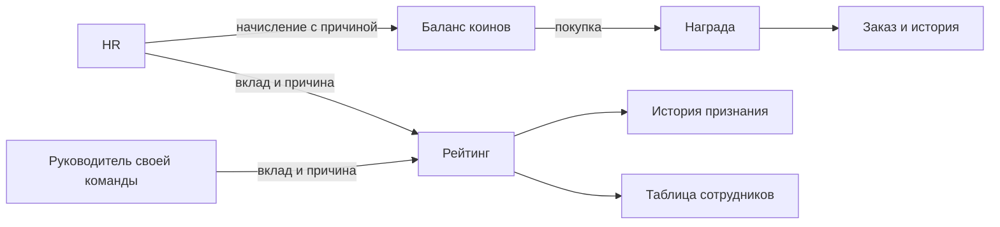
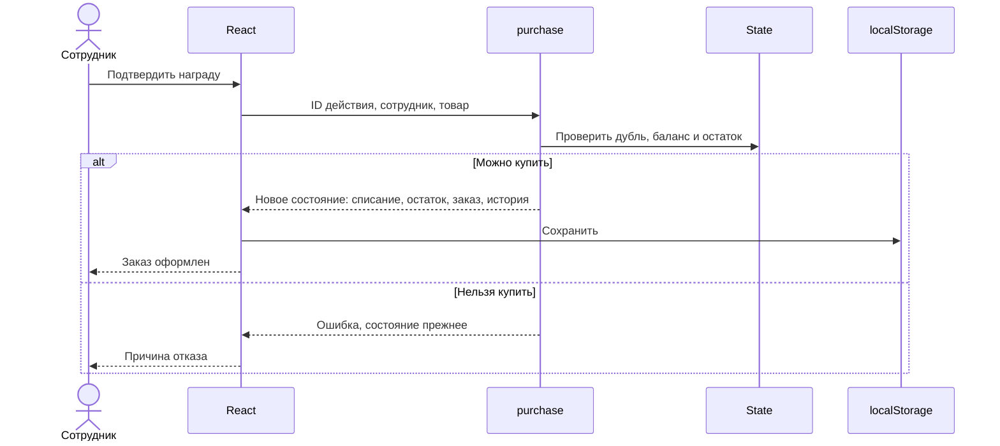

# Архитектура прототипа

React держит единое состояние State. Синхронные доменные функции возвращают новое состояние; UI применяет его через актуальный ref, затем сохраняет в localStorage. Уникальный ID действия входит в processed и блокирует повторную обработку. Серверной защиты ролей нет — это демонстрация.

Модели: Employee (роль, подразделение, коины, рейтинг); Entry (тип, сумма, причина, автор, получатель, дата); Product (категория, цена, остаток); Order (снимок названия и цены на момент заказа). Начальные балансы включают накопленное до демонстрационного периода; история показывает отдельные последние операции, а не полную бухгалтерскую реконструкцию.

Места в таблице считаются по всему банку: 1 + число сотрудников с большим рейтингом. Фильтр подразделения не пересчитывает глобальное место. Для равных баллов порядок строк алфавитный, место одинаковое.
