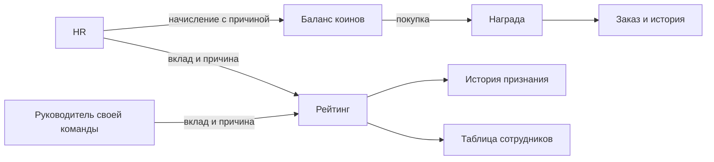
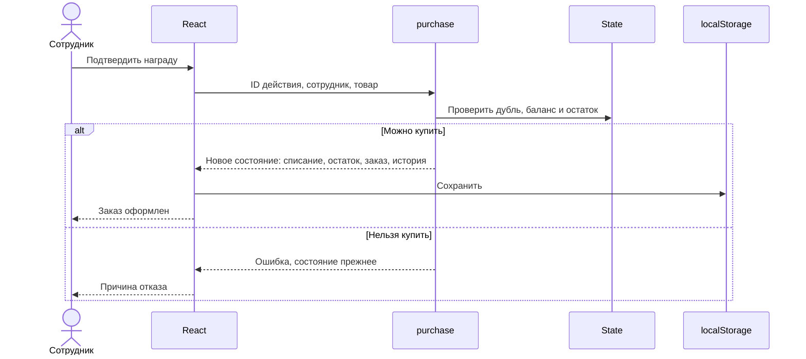

# Архитектура прототипа

React держит единое состояние State. Синхронные доменные функции возвращают новое состояние; UI применяет его через актуальный ref, затем сохраняет в localStorage. Уникальный ID действия входит в processed и блокирует повторную обработку. Серверной защиты ролей нет — это демонстрация.

Модели: Employee (роль, подразделение, коины, рейтинг); Entry (тип, сумма, причина, автор, получатель, дата); Product (категория, цена, остаток); Order (снимок названия и цены на момент заказа). Начальные балансы включают накопленное до демонстрационного периода; история показывает отдельные последние операции, а не полную бухгалтерскую реконструкцию.

Общебанковский топ удалён из UI после получения материалов по кабинету рейтинга. Вместо него — личный прогресс и список своей демогруппы по подразделению и роли, без публикации мест. Сотрудники и руководители не смешиваются.

## Тарифные начисления коинов (31.10)

`src/domain/coins.ts` содержит сценарную политику и `awardCoins`. `grant` обслуживает только ручной рейтинг и отклоняет произвольную выдачу коинов. `awardCoins` проверяет HR, получателя, тариф, причину, ID и дату события, квоту сотрудника, дубликаты и годовой выпуск; затем атомарно меняет баланс, историю, `coinAwards` и `processed`. Рейтинг и каталог не меняются.

`coinAwards` хранит отдельный реестр событий с датой события и датой начисления. Уникальность: сотрудник + ID события; разовые этапы ограничены за всё время, календарные — в текущем году. Границы по Москве. Из-за отсутствия HR-интеграций права на день рождения, onboarding и остальные события подтверждаются человеком.

Годовой выпуск считается по положительным coin-записям истории, включая прежние ручные начисления. Расходы не возвращают квоту. Значения сценария — из материалов Никиты от 31.10; бюджет всего банка в локальном демо не отслеживается. Если полный тариф не помещается в потолок, состояние не меняется.

Ключ и версия localStorage сохраняются. При чтении старого v1 добавляется пустой `coinAwards`; старые операции без типа/ID события не реконструируются в персональные квоты. Балансы, история заказов и обработанные ID сохраняются. Цены трёх сертификатов обновляются в каталоге по курсу 5:1; уже оформленные заказы хранят свой снимок цены.

## Кабинет рейтинга и очередь достижений

`src/domain/rating.ts` реализует заявки, маршруты проверки, журнал, обращения и отмену ошибочных начислений, благодарности, программы и изолированный учебный расчёт командных показателей. `src/components/rating-workspace.tsx` — личный кабинет и рабочее место. Все операции выполняются через актуальный State ref и общую идемпотентность.

В `recognition` хранятся requests, thanks, applications. Новый раздел мигрирует без сброса старого демо. Подтверждение атомарно меняет статус заявки, историю, накопленную сумму и processed. Дата учёта — московский день подтверждения; накопленная история сохраняется, 12 месяцев — вычисляемое окно тех же действующих начислений. Исправление создаёт связанную обратную запись, исключает исходное начисление из действующих и сохраняет журнал. Программы не расходуют рейтинг или коины.

Полномочия определяются непосредственным назначением: профессиональный вклад и управление — руководителю, социальный — HR; самоподтверждение исключено. `grant` остаётся низкоуровневой совместимой ручной операцией, но UI новых рейтинговых начислений использует только подтверждение карточки. Нет серверной защиты, реальные данные в демо не используются. Подробности, параметры и сценарий проверки — [rating-implementation.md](rating-implementation.md).
